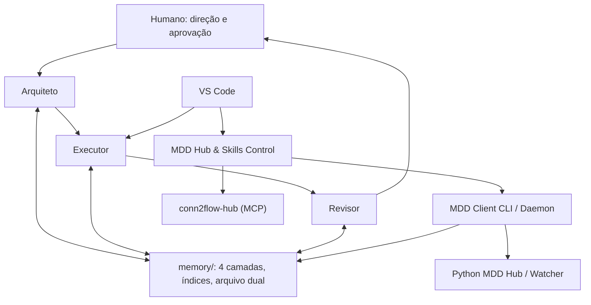

# Conn2Flow AI Workspace

### O sistema operacional de Memory-Driven Development para engenharia multiagente

[English](README.md) · [Documentação](docs/pt-br/README.md)

   

Projetos longos com IA perdem contexto entre sessões. **Memory-Driven Development (MDD)** mantém especificações, decisões, evidências de execução e procedimentos reutilizáveis no Git para que o próximo agente retome o trabalho por um índice pequeno e fontes verificadas.

O **MDD evolui o Spec-Driven Development (SDD)**: preserva especificações e validação e acrescenta memória persistente. O workspace oferece o MDD Client para memória local, o MDD Hub Python para relatórios e monitoramento de documentação e a extensão Conn2Flow Tools v1.2.0 para VS Code. As skills gerais servem a qualquer projeto, e as específicas dão suporte ao ecossistema PHP e de recursos do Conn2Flow.

## Como as partes se conectam

Quatro camadas separam episódios, conhecimento aprovado, procedimentos e observações raw. Índices hierárquicos orientam a consulta; arquivos duais preservam uma síntese concisa e a evidência original.

Aprendizados verificados ficam em [`memory/learnings/`](memory/learnings/index.md), e sugestões de melhoria seguem para [`memory/inbox/feedback/`](memory/inbox/feedback/index.md). O [índice determinístico](.gemini/skills/index.md) reúne **48 skills**, mostra o **Skill Budget** por categoria e aponta tópicos detalhados sob `subskills/`. As cinco personas canônicas são:

- [`c2f-persona-architect`](.gemini/skills/c2f-persona-architect/SKILL.md)
- [`c2f-persona-executor`](.gemini/skills/c2f-persona-executor/SKILL.md)
- [`c2f-persona-reviewer`](.gemini/skills/c2f-persona-reviewer/SKILL.md)
- [`c2f-persona-curator`](.gemini/skills/c2f-persona-curator/SKILL.md)
- [`c2f-persona-optimizer`](.gemini/skills/c2f-persona-optimizer/SKILL.md)

## Quickstart em três passos

1. **Instale o Client.** Na raiz, com Python 3.11+ e um ambiente virtual ativo, rode `python -m pip install -e tools/mdd-client`. Para provisionar um projeto, rode `mdd init ./my-project --type software --kits`.
2. **Instale a extensão.** Abra o VS Code e use **Extensões → Instalar do VSIX** com `vscode-extension/conn2flow-tools-1.2.0.vsix`. O [guia do painel](docs/pt-br/GUIA-PAINEL-DEV-TOOLS-VSCODE.md) descreve a configuração e os controles.
3. **Abra a requisição e ative a persona.** Leia `memory/human-requests/CURRENT.md` quando disponível e o `index.md` da área. Selecione escopo, topologia e autonomia, invoque a persona pelo nome da skill e registre as verificações antes da revisão.

## Explore a documentação

| Guia | Conteúdo |
| --- | --- |
| [Mecânica de memória e retenção](docs/pt-br/ESPECIFICACAO-FRAMEWORK-MDD.md) | Quatro camadas, 10 ativos, 50 KB e arquivos. |
| [Client e Hub em Python](docs/pt-br/GUIA-ECOSSISTEMA-PYTHON-MDD.md) | Comandos do Client e modos de evolução do Hub. |
| [Arquiteto, Executor, Revisor](docs/pt-br/ARQUITETURA-AGENTE-DUPLO.md) | Responsabilidades e revisão independente. |
| [48 skills canônicas](docs/pt-br/CATALOGO-DE-SKILLS.md) | Quando carregar cada procedimento. |
| [CLI Core e MCP](docs/pt-br/GUIA-RAPIDO-CLI-E-MCP.md) | Ferramentas disponíveis e configuração. |
| [Painel VS Code](docs/pt-br/GUIA-PAINEL-DEV-TOOLS-VSCODE.md) | Controles, choques e MDD Hub & Skills Control. |
| [Fluxo multiagente](docs/pt-br/PLAYBOOK-ORQUESTRACAO-MULTI-AGENTES.md) | Do briefing ao recibo verificável. |
| [Roteiro e estado das entregas](docs/pt-br/ROTEIRO-EVOLUCAO-FUTURA.md) | Implementado, aprovado e incubado. |
| [Empacotamento e publicação da extensão](docs/pt-br/GUIA-PUBLICACAO-VSCODE-MARKETPLACE.md) | Manifesto, pacote e verificações locais. |

## O que está disponível

O barramento federado usa `mdd feedback submit/list/triage`. Sem acesso à matriz, `submit --github` abre uma issue com o rótulo `skill-feedback`. Os dois servidores MCP, `conn2flow-hub` e `mdd mcp`, expõem envio e listagem. Use `mdd eval` para rodar os cenários determinísticos de regressão. No VS Code, **MDD Hub & Skills Control** acompanha os processos e permite listar e triar feedbacks. A descoberta de memória usa `memory/` com fallback para `sdd/`. Consulte o [changelog](CHANGELOG.md).

Confira comportamentos no código e na configuração vigente. A documentação distingue implementação de intenção; uma memória antiga nunca prevalece sobre a fonte atual. Consulte a [LICENSE](LICENSE).

## Sugestão de descrição e tópicos para o GitHub

**Descrição:** Memory-Driven Development para engenharia multiagente: memória persistente de projeto, 48 skills, painel VS Code e ferramentas Python.

**Tópicos:** `memory-driven-development`, `multi-agent`, `ai-engineering`, `agent-skills`, `mcp`, `vscode-extension`, `python`, `developer-tools`, `conn2flow`.
