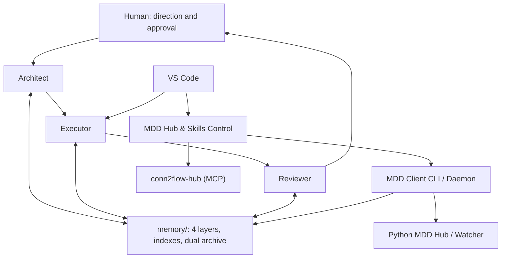

# Conn2Flow AI Workspace

### The Memory-Driven Development operating system for multi-agent engineering

[Português](README-PT-BR.md) · [Documentation](docs/en/README.md)

   

Long-running AI projects lose context between sessions. **Memory-Driven Development (MDD)** keeps specifications, decisions, execution evidence and reusable procedures in Git so the next agent can resume from a small index and verified sources.

**MDD builds on Spec-Driven Development (SDD)** by adding persistent memory to specifications and validation. The workspace provides MDD Client for local memory, the Python MDD Hub for reports and documentation monitoring, and Conn2Flow Tools v1.2.0 for VS Code. General skills apply to any project, while Conn2Flow skills support its PHP and resource ecosystem.

## How it fits together

Four layers separate episodes, approved knowledge, procedures and raw observations. Hierarchical indexes guide retrieval; dual archives preserve both a concise summary and the original evidence.

Verified lessons live in [`memory/learnings/`](memory/learnings/index.md), and improvement proposals go to [`memory/inbox/feedback/`](memory/inbox/feedback/index.md). The [generated skills index](.gemini/skills/index.md) covers **48 skills**, shows the **Skill Budget** by category and points to detailed topics in `subskills/`. The five canonical personas are:

- [`c2f-persona-architect`](.gemini/skills/c2f-persona-architect/SKILL.md)
- [`c2f-persona-executor`](.gemini/skills/c2f-persona-executor/SKILL.md)
- [`c2f-persona-reviewer`](.gemini/skills/c2f-persona-reviewer/SKILL.md)
- [`c2f-persona-curator`](.gemini/skills/c2f-persona-curator/SKILL.md)
- [`c2f-persona-optimizer`](.gemini/skills/c2f-persona-optimizer/SKILL.md)

## Quickstart in three steps

1. **Install the Client.** From the root, with Python 3.11+ and an activated virtual environment, run `python -m pip install -e tools/mdd-client`. To set up a project, run `mdd init ./my-project --type software --kits`.
2. **Install the extension.** In VS Code, choose **Extensions → Install from VSIX** and select `vscode-extension/conn2flow-tools-1.2.0.vsix`. The [panel guide](docs/en/VSCODE-DEV-TOOLS-PANEL-GUIDE.md) explains configuration and controls.
3. **Open the request and activate a persona.** Read `memory/human-requests/CURRENT.md` when available and the relevant `index.md`. Select repository scope, topology and autonomy, invoke the persona by skill name and record the checks before review.

## Explore the documentation

| Guide | Contents |
| --- | --- |
| [Memory mechanics and retention](docs/en/MDD-FRAMEWORK-SPECIFICATION.md) | Four layers, 10 active items, 50 KB and archives. |
| [Python Client and Hub](docs/en/MDD-PYTHON-ECOSYSTEM-GUIDE.md) | Client commands and Hub evolution modes. |
| [Architect, Executor, Reviewer](docs/en/DOUBLE-AGENT-ARCHITECTURE.md) | Responsibilities and independent review. |
| [48 canonical skills](docs/en/SKILLS-CATALOG.md) | When to load each procedure. |
| [Core CLI and MCP](docs/en/QUICKSTART-CLI-AND-MCP.md) | Available tools and configuration. |
| [VS Code panel](docs/en/VSCODE-DEV-TOOLS-PANEL-GUIDE.md) | Controls, conflicts and MDD Hub & Skills Control. |
| [Multi-agent workflow](docs/en/MULTI-AGENT-ORCHESTRATION-PLAYBOOK.md) | From briefing to verifiable receipt. |
| [Roadmap and delivery status](docs/en/FUTURE-EVOLUTION-ROADMAP.md) | Implemented, approved and incubated. |
| [Extension packaging and publishing](docs/en/VSCODE-MARKETPLACE-PUBLISHING-GUIDE.md) | Manifest, package and local checks. |

## What is available

The federated feedback bus uses `mdd feedback submit/list/triage`. Without access to the matrix, `submit --github` opens an issue labeled `skill-feedback`. Both MCP servers, `conn2flow-hub` and `mdd mcp`, expose submission and listing. Run `mdd eval` to check deterministic skill regression scenarios. In VS Code, **MDD Hub & Skills Control** monitors the processes and lists and triages feedback. Memory discovery prefers `memory/` and falls back to `sdd/`. See the [changelog](CHANGELOG.md).

Use the code and current configuration to check behavior. Documentation distinguishes implementation from intent; an old memory entry never overrides current source. See [LICENSE](LICENSE).

## Suggested GitHub description and topics

**Description:** Memory-Driven Development for multi-agent engineering: persistent project memory, 48 skills, a VS Code panel and Python tooling.

**Topics:** `memory-driven-development`, `multi-agent`, `ai-engineering`, `agent-skills`, `mcp`, `vscode-extension`, `python`, `developer-tools`, `conn2flow`.
