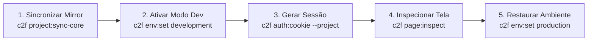

# Visual Inspection and Validation Automated in Conn2Flow Local Environment

# ⚡ MANDATORY TRIGGER
- **TRIGGER**: Validate rendering visual, computed styles (`getComputedStyle`), CSS animations (`getAnimations`), JavaScript console errors or authenticated Gestor routes in the local test environment (Docker).
- **SKIP ONLY IF**: purely backend tasks CLI or migrations without rendering screen.
- **CONSEQUENCE OF IGNORING**: Leave outstanding items like "Awaits human acceptance Visual Operator", spending extra context rounds and masking visual bugs (e.g. `@media (prefers-reduced-motion)` or hidden CSS classes).

---

## 🔄 Canon Life Cycle of 5 Steps



### Protocol Step by step:

#### Step 1: Mirror Synchronization (If Core has been modified)
```bash
./c2f project:sync-core <projectID>
```
* Ensures that the local test mirror (`dev-environment/data/sites/localhost/<site>/`) has the latest Core functions and libraries.

#### Step 2: Developer Mode Activation
```bash
./c2f env:set development --project=<projectID>
```
* Activates development flags and cookies relaxation on connections Local HTTP. HTML/CSS continue to come from SQL; `resources/` is the authored seed that must be synchronized by pipeline. *

#### Step 3: Cookie Jar Server-Side Generation
```bash
./c2f auth:cookie --project=<projectID>
```
*Genera `temp/agent-cookies.txt` with the session credentials authenticated by runtime inside the Docker container. *

#### Step 4: Visual Inspection and Evidence Collection (HTML Verbatim with Sanitization Bypass)
```bash
./c2f page:inspect "http://localhost/<site>/<rota>" --selector="<seletor>" --computed="display,opacity,transform" --screenshot
```
* Run Chrome Headless via Playwright, inject session cookies and return JSON with HTTP status, JS console errors, computed styles and PNG screenshot.*
> [!NOTE]
> As the agent session uses administrator authentication (`auth:cookie`), the HTML sanitizer is **automatically bypassed** (`gestor_dashboard_toolbar_ativo() === true`). The agent receives HTML with intact architecture comments, sections (`data-id`, `data-title`) and widget markers (`<!-- widgets#... -->`).

#### Step 5: Restoration of the Required Tear Down
```bash
./c2f env:set production --project=<projectID>
```
*Restore the `.env` production mode of the project and safely complete the test cycle. *

---

## 🛠️ Troubleshooting Guide

1. **`DB_HOST=mysql` & Database Connectivity**:
   - The commands that access database (`auth:cookie`, `db:test`) depend on the active Docker `conn2flow-app` / `mysql` container.
2. **`503 .env not found`**:
   - If project does not locate the `.env` file, make sure you pass `--project=<projectID>` and check that `path_tests` is configured correctly in `dev-environment/data/environment.json`.
3. **False Negative by Out-of-date Core**:
   - If a new core function is not found while running the page in the mirror, immediately run the **Step 1** (`./c2f project:sync-core <projectID>`).

---

## 🎨 CSS Audit on Inspected Screens

After visual inspection (Step 4), the agent can complement validation with CSS audit to identify orphaned classes, outdated derived CSS or technical debt of Tailwind classes in PHP/JS:

```bash
./c2f css:audit --url=<rota-inspecionada>
```

This command reads the actual composite page (layout + rendered components) and maps:
- CSS classes declared but not used in rendered HTML.
- Tailwind classes dynamically generated by PHP/JS (technical debt).
- Divergences between `css_compiled` in database and the CSS that should be derived from the current HTML.

---

## 🌐 E2E Validation Screenplay in Restricted Remote Access (Read-Only)

In human acceptance/Lab environments where the agent has log and HTTP reading credentials, but **no writing permission via SSH/SCP**, follow this 8-step protocol for full validation:

1. **Administration Session Injection via Cookie Jar**:
   - Extract the administrative session with `./c2f auth:cookie --project=<id>` for the Netscape jar in `temp/agent-cookies.txt`.
   - Inject to Playwright via `context.addCookies()` to navigate narrow panel routes.

2. **Navigation Context Insulation**:
   - Keep separate contexts in the browser: a clean context (incognito) to simulate the anonymous visitor and a context with cookies authenticated to the buyer/administrator.

3. **Filling Safe Components in iFrames**:
   - For embedded payment elements (e.g. Stripe Payment Element):
   ```javascript
   const iframe = page.frameLocator('#checkout-payment-element iframe').first();
   await iframe.locator('input[name="number"]').fill('4242424242424242');
   ```
   - Always wait for the status of the form before submitting.

4. **Native Dialogue Interception**:
   - Configure `page.on('dialog', d => d.accept())` to handle `window.confirm` or `alert` natives without blocking automation.

5. **Database Audit by Administrative Interface**:
   - In the impossibility of running direct SQL Queries on the remote server, auditing states browsing to the registration detail screens (e.g. request detail on Gestor) and inspecting rendered values.

6. **Webhooks Test via Direct HTTP Injection**:
   - Fire requests POST with authentic gateway payloads directly in public endpoint (`.ajax.public.php`).
   - Resend the same payload and check in the request interface if the event has been deduplicated (dempotence).

7. **Network Traffic Audit (Foreign SDKs)**:
   - Monitor requests with `page.on('request', req => ...)` to make sure that third-party heavy SDKs (e.g. PayPal) are not downloaded when another gateway is active.

8. **Log Sanitization and Console Output**:
   - Mask tokens, secret gateway keys and authentication cookies before registering evidence in the terminal or log files.

---

## ⛔ Inviolable Inspection Rules:
1. **EXCLUSIVE FOR LOCAL ENVIRONMENT OF TESTS**: NEVER perform automated inspection, auth or scraping on production URLs.
2. **SDD Log**: Evidence of inspection (JSON of `page:inspect` and screenshots) MUST be registered directly in the `VALIDATION-CHECKLIST.md` of the repository instead of marking "operator pendant".
3. **Required Tear Down**: Always finish restoring the environment with `c2f env:set production --project=<projectID>`.

## Active Inspection with Chrome DevTools MCP

Use `chrome-devtools` when validation requires interaction on a live page. Preserve `c2f page:inspect` as an automated alternative when MCP is not available. Runtime serves SQL HTML/CSS: sync by the official pipeline before inspecting; development mode does not waive database synchronization.

- In the `conn2flow-ai-workspace` matrix, run `scripts/mcp/launch-devtools-chrome.ps1 -Headless` (default) or `-Visible`. The profile is `%TEMP%\conn2flow-chrome-sandbox`, separated from personal Chrome. To use this instance, add `--browser-url=http://127.0.0.1:9222` to the MCP arguments; the canonical configuration without this argument starts another browser itself. Use Node LTS compatible with the package installed (1.10.1 requires Node 20.19+ or 22.12+).
- Select the page with `list_pages`/`select_page` and use `navigate_page` only in the local test URL. The session created by `c2f auth:cookie` is not automatically transferred to MCP: authenticate sandbox by test flow or inject jar by CDP/Playwright in the isolated context, preserving `HttpOnly`, domain and path. Never copy personal browser cookies or print them on evidence.
- Get `take_snapshot` before `click`, `fill` or `press_key`; it represents the accessibility tree and provides UIDs, not the full HTML DOM. Reset snapshot after dynamic changes and wait for expected status with `wait_for`.
- Collect `take_screenshot` before/after interaction and on desktop/mobile viewsports with `resize_page`. Check alignment, overflow, readability and control status. Isolated snapshot does not prove the visual layout.
- To measure real DOM, use `evaluate_script` read-only: `getBoundingClientRect()`, `getComputedStyle()` and `getAnimations()`, returning serializable values. Register selector, node existence, dimensions, display, opacity and overflow. If the session uses `--no-javascript-evaluation`, these measurements are unavailable; register the limitation and use screenshot/snapshot or CLI available.
- In modals, validate opening, overlay, focus, scroll and button/scape closing, including unduplicated reopening. In previews, check load and iframe dimensions; respect cross-origin and do not try to bypass CSP. In editors Quill, check `.ql-container`, `.ql-toolbar` and synchronization of the hidden input after editing in the test environment.
- Inspect console/network as `c2f-javascript-ajax`; register URL, viewport, action, expected/observed result and catch paths on the checklist. Mask tokens/cookies and close only the created PID sandbox without closing personal sessions.

See the schema of the tools displayed by the installed version, including `pageId` when required. Reference: [Chrome DevTools MCP](https://github.com/ChromeDevTools/chrome-devtools-mcp/blob/main/docs/tool-reference.md).

---

## 🧪 SSH test environment (without Docker): the cycle that works

The five-step cycle above was born into the Docker mirror. In a project with `deploy_mode: ssh` (the destination is a VM), use:

1. `./c2f project:deploy <id>` from core: that's what takes code and content to the environment.
2. `./c2f auth:cookie --project=<id>` (and `--user=<n>` for another user) generates the jar by SSH.
3. For the edit bar to appear in Playwright, also add the profile cookie to the context; only the session cookie is not enough.
4. `ignoreHTTPSErrors: true` in context: the test environment certificate is local.

Do not change the environment mode for development only to inspect: the page served by database is what the visitor sees.

### What every page validation should check

- HTTP 200 and no console error (`pageerror` and `console.error`).
- No horizontal scrolling: `document.documentElement.scrollWidth - window.innerWidth <= 0`, 1280 and 390 px.
- No raw marker in text (`[[`, `]]@`, Markdown crash, `**`).
- **Class without rule**: element with background class (`bg-...`) whose computed `backgroundColor` has become transparent. This is how the outdated CSS appears.
- **New content indeed**: compare a portion of the body, not just the title.
- Internal links: collect the `href` from the page and check that everyone answers 200.

Delete the header and footer of the class conference site: the menu drawer becomes transparent when closed and generates false positive.

### Validate with idle environment

Deploy of another agent in progress produces 500/503 passengers. See `c2f-project-pipeline-and-tasks` Rule #10 before registering a failure.

### Save scripts

Validation script written during batch goes to `sdd/validation/` of repository, with the result JSON. Script that is only in the temporary session folder cannot be repeated by anyone.

## REQ-077 — Pipeline, worktrees and preservation (DEC-136)

- Project: `./c2f project:deploy <id>` is the default (95% of cases). Core: `./c2f manager:update-all`. `./c2f project:update-all <id>` is prohibited in the routine of project; allowed exclusively in batch altering Core and project simultaneously.
- Before deploy, check `git branch --show-current` and `git status --short` at the origin; do not publish other/unfinished work. Check your destination and your clearance. Category B (skills/documentation/tests/memory): only local checks, without deploy. Sequence execution, foreground, logs and locks remain mandatory.
- Worktrees for convenience are forbidden. Only create with concurrency multi-agent proven in the same repository; in doubt consult the human before. Register original root, temporary path and concurrency on request and batch. When completing/homologing, audit unique work, integration into main and junctions, then `git worktree remove <caminho>` and `git worktree prune`. Never use force to destroy unintegrated work; preserve and report impediments.
- DEC-136: maintain by default; nothing is removed (file, `status='D'`, `DELETE`) without explicit confirmation from the human operator. Withdrawal turns clash pending; `--confirmar-retirada` only when requested by the operator. Source incomplete does not authorize withdrawal.
