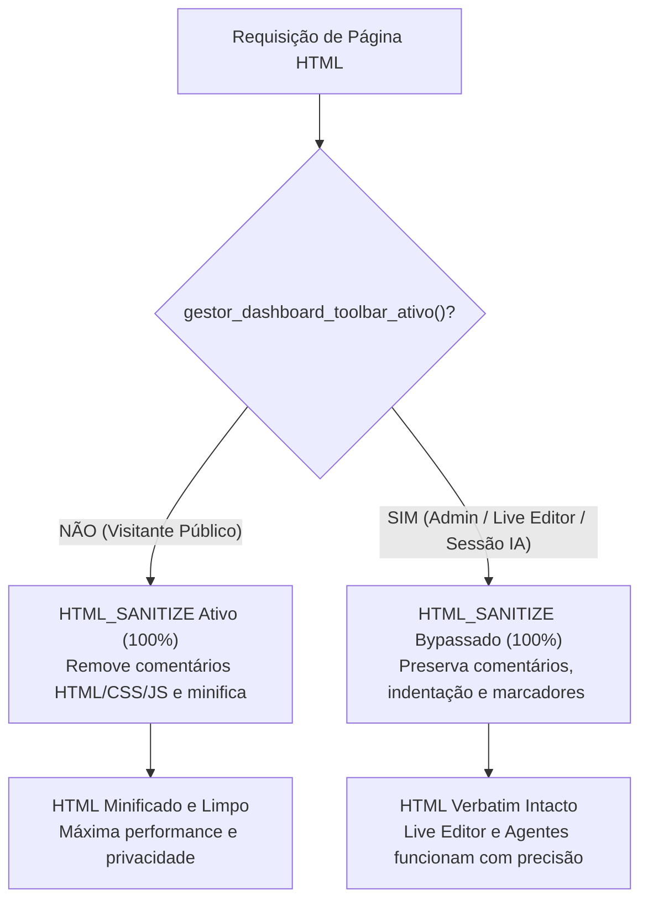

# Governance of HTML, CSS and Markdown Files in Conn2Flow

# ⚡ MANDATORY TRIGGER
- **TRIGGER**: Write, edit or migrate HTML tags, CSS styles or system layouts.
- **SKIP ONLY IF**: Purely backend logic manipulation in PHP or APIs without visual rendering.
- **CONSEQUENCE OF IGNORING**: Creating loose static files that are ignored by the synchronization pipeline, do not reach database and generate 404 pages in production.

---

> [!WARNING]
> **AGENT ATTENTION: PROHIBITED TO CREATE SOLVE STATIC ARCHIVES**
> NEVER create files `.html`, `.css` or `.md` loose at the root of the project, in static public directories (e.g. `public/`, `assets/`) or at the root of PHP modules!

## 1. Resource System Obligation (`c2f-resources-system`)

In Conn2Flow, **all visual content or textual instruction** (pages, layouts, components, templates, variables and IA prompts) You must reside in **Resource System** (`resources/`).

### Where files are to be created:

1. **Global Resources**:
   - Pages: `gestor/resources/<idioma>/pages/<id>/<id>.html`
   - Layouts: `gestor/resources/<idioma>/layouts/<id>/<id>.html`
   - Components: `gestor/resources/<idioma>/components/<id>/<id>.html`

2. **Module Resources**:
   - Pages: `modulos/<modulo-id>/resources/<idioma>/pages/<id>/<id>.html`
   - Components: `modulos/<modulo-id>/resources/<idioma>/components/<id>/<id>.html`

---

## 2. The Architecture Rule of 2 `HTML_SANITIZE` Levels

Conn2Flow implements smart, forked HTML delivery controlled by the `HTML_SANITIZE` variable in `.env`:

### A. Public Visitor / Anonymous (`gestor_dashboard_toolbar_ativo() === false`):
* `gestor_html_higienizar()` runs **100%**, removing all comments (`<!-- ... -->`, `/* ... */`, `// ...`) and compacting whitespaces.
* **Result**: Safety, privacy and maximum performance for the general public (zero leak of internal comments or engineering notes).

### B. Authenticated Administrator / Live Editor / IA Session (`gestor_dashboard_toolbar_ativo() === true`):
* `gestor_pagina_higienizar_ativo()` returns **`false` unconditionally**.
* The HTML sanitizer is **100% BYPASED / OFF**.
* **Result**: HTML is delivered **exactly as in the original** — with all reasoning comments, architectural notes, sections (`data-id`, `data-title`) and widget markers (`<!-- widgets#... -->` and `<!-- /widgets#... -->`) preserved intact for the functioning of Live Editor (`dashboard.toolbar.js`) and IA inspection tools.

---

## 3. HTTP Probe Guidelines: Probe Browser, Backend Report

> [!WARNING]
> * * Every HTTP connectivity probe, rewrite or healthcheck URL must be triggered asynchronously by
> front-end (navigator/JavaScript). NEVER by synchronous loopback cURL within the PHP process itself in web mode.**

The local PHP-FPM, Docker or single-pool VPS has few workers. If the page being rendered opens
a cURL for the **Host itself**, it holds a worker waiting for another worker to meet the probe. With the pool full,
No answer: the probe only returns on timeout and the screen locks. It's self-requisition deadlock -- it's not slow network,
and increase the timeout gets worse.

### Division of responsibilities

|Layer|Liability|Forbidden|
| --- | --- | --- |
|**Front-end (page/component JS)**|Fire the asynchronous `fetch` from the probe and send the verdict to the backend.|Lock down the rendering waiting for the probe.|
|**Backend (PHP, web mode)**|Mount the probe plane (target URL, expected response, configuration snippet) and **log** the received verdict.|Open curl to the host itself.|
|**Backend (CLI/headless)**|Run the probe directly — there is no browser and the runner does not compete for the pool.|Assume SAPI web.|

### Rules

1. The healthcheck element declares the HTML route (`data-api-url`), and the JS does the `fetch` asynchronous with
   `cache: 'no-store'`, reflecting state on screen (pending badge → active/inactive) without locking the form.
2. The backend exposes the diagnostic route by a **deterministic** path, which does not depend on resource
   diagnosed (e.g. accept `?api=rewrite-probe` plus `api/rewrite-probe`, since the beautiful route depends on
   Rewrite itself under test).
3. The server probe is behind an explicit SAPI check (`if (!InstallerGuard::isCli()) return null;`).
4. The report distinguishes the origin of the verdict (`cliente`, `servidor`, `indisponivel`) so the screen can say
   to the operator that the verification was undetermined instead of lying a "OK".

### Reference implementation (REQ-027/REQ-028)

* `gestor-instalador/assets/js/installer.js` — the browser fires the probe and returns `rewrite_ok`.
* `gestor-instalador/views/installer.php` — `
`.
* `gestor-instalador/index.php` — API route and direct probe response before session/lock.
* `gestor-instalador/src/Installer.php` — `rewriteProbeReport()` (report) and `probeRewrite()` (CLI only).

Details of scripts and CLI console contract are on skill **`c2f-dev-scripts`**.

---

### Next Required Step:
See and apply skill main **`c2f-resources-system`** for compilation (`c2f resources:sync`), metadata in JSON files and assignment of sections (`data-id` and `data-title`).
